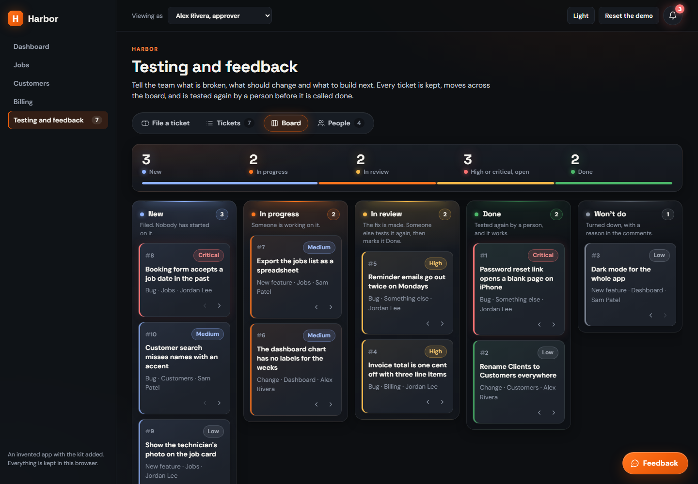
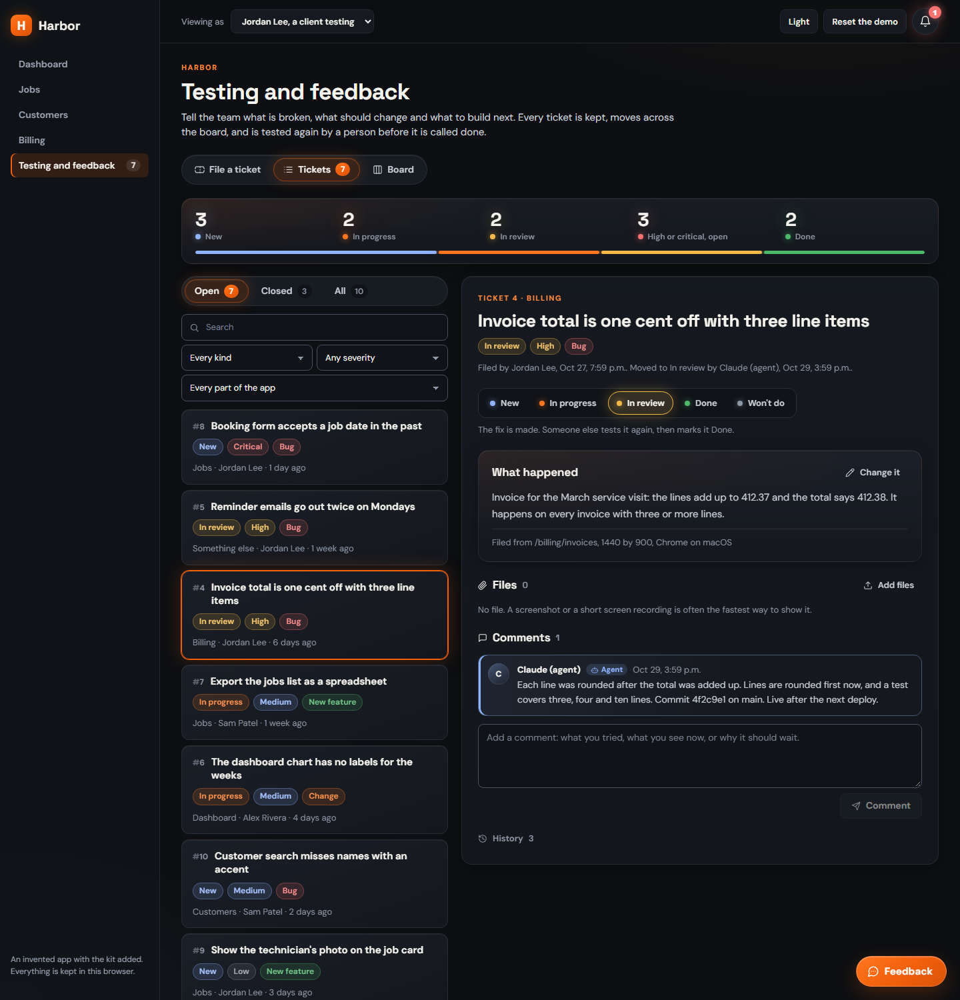
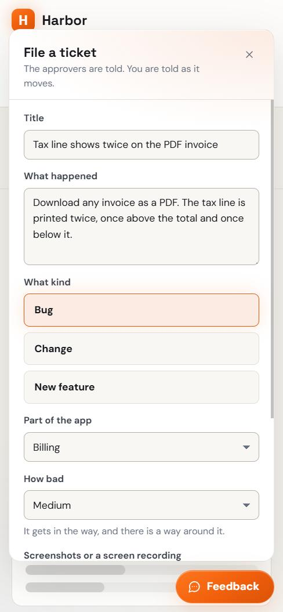

# Testing and Feedback Kit

A testing and feedback board you add to your own app with Claude Code. The people using your app file bugs, changes
and feature requests from any page. Your AI agents work them as a queue and hand each fix back. Only a person marks a
ticket Done, after testing it again.



> "anytime my team says it is done, I have this number in my mind, it's only 75% done."
>
> Mani Kanasani, [How to Sell AI Employees, at 11:30:00](https://www.youtube.com/watch?v=pzCFaU62KgI&t=41400s)

A build passes its demo, and the first real person who uses it finds what the demo never showed. This kit is the
part of our process that catches that: a feedback button inside the product, a board every ticket lands on, and one
rule that matters more than the rest. Whoever built the fix does not get to call it done.

> "I would rather have you test it and then mark it done instead of me marking it done by myself."
>
> [The same video, at 11:35:00](https://www.youtube.com/watch?v=pzCFaU62KgI&t=41700s)

## What you get

- **A Feedback page** with File a ticket, Tickets (a list with filters and the ticket beside it) and a Board you drag
  cards across. Approvers also get People, to add the team, clients who test, and agents.
- **A floating Feedback button** on every page of your app. A ticket filed from it carries the page and the screen
  size, so nobody has to explain where it happened.
- **A bell** for your top bar. Approvers hear about every new ticket; whoever filed a ticket hears every move and
  comment on it.
- **The database for Supabase**: six tables, the functions that write them, row level security, and a private bucket
  for screenshots and recordings. Every rule is kept by the database, whatever screen or agent is calling.
- **An agent server (MCP)** so Claude Code can list the open tickets, read one, comment, and move it to In review.
- **A skill** that teaches the agent the loop: take the next ticket, fix it, explain it, hand it back.
- **A demo** that runs with nothing to set up.

## Try the demo

```bash
git clone https://github.com/mani-kanasani/testing-feedback-kit
```

```bash
cd testing-feedback-kit && npm install && npm run demo
```

Open http://127.0.0.1:4791. At the top you can be the approver, a client testing the app, or the agent. Press
Feedback at the bottom right on any page. Everything in the demo stays in your browser.

## Add it to your app with Claude Code

Open Claude Code in your app's folder and paste this. It reads [INSTALL.md](INSTALL.md), looks at your app, tells you
its plan and asks you three things before it changes anything.

```text
Add the Testing and Feedback Kit to this app: https://github.com/mani-kanasani/testing-feedback-kit

1. Clone it with git clone --depth 1 into a temporary folder outside this project, and read its INSTALL.md from start
   to end before you change anything here.
2. Look at this app as INSTALL.md step 1 says: the framework, the router, the backend and sign-in, the layout, the
   menu and the theme. Tell me in a few lines what you found and your plan, then ask me what step 1 asks, each as two
   or three choices with the one you recommend.
3. Then follow INSTALL.md step by step: copy the kit in, the styles in this app's colours, the database on my local
   or development database only, the page, the menu item, the floating button, the bell, and the agent if I said yes.
4. Check it the way INSTALL.md step 8 says, look at the page in a browser at a phone's width and at a laptop's, and
   tell me what you checked and what you did not.

Rules: never print or commit a key or a password. Never put the service role key in browser code or in the agent
server. Do not touch my production database, or deploy, without my yes in this conversation. Change nothing in the
app that the kit does not need.
```

It fits best in a React app on Supabase. Another backend works too: the screens talk to one small interface, and
INSTALL.md lists the rules your server has to keep, with a test that checks them. On another framework, Claude Code
ports the screens and keeps the rest.

Once it is in, say **"Work the feedback queue"** in Claude Code. It takes the most urgent open ticket, fixes it, says
what changed, and moves it to In review for a person to test.

## How a ticket moves

| Status | What it means |
|---|---|
| New | Filed. Nobody has started on it. |
| In progress | Someone, or an agent, is working on it. |
| In review | The fix is made. Someone else tests it again, then marks it Done. |
| Done | Tested again by a person, and it works. |
| Won't do | Turned down, with a reason in the comments. Nothing is ever deleted. |



## The rules the database keeps

1. Only people on the feedback list see or touch anything.
2. Only whoever filed a ticket, or an approver, changes what it says. Anyone on the list moves it and comments.
3. An agent never marks a ticket Done or Won't do.
4. A ticket is marked Done only from In review, and never by whoever moved it there. Someone else tests it.
5. Every change is written to the ticket's history by the database, in words.

The screens show the same rules before you hit them: a move you may not make is greyed out, with the reason.

| Role | May |
|---|---|
| Approver | Everything a member may, change any ticket, and manage the list |
| Member | File, move, comment, and close a ticket someone else moved to In review |
| Agent | Read, comment, and move a ticket to New, In progress or In review |

Everyone on the list sees every ticket. The kit is made for a team and the people who test with it.

## For your agents

| Tool | Does |
|---|---|
| `list_tickets` | The open tickets as a queue, the most severe first, then the oldest |
| `get_ticket` | One ticket in full, with links to its files and its comments and history |
| `comment_on_ticket` | A comment as the agent; whoever filed the ticket is told |
| `move_ticket` | New, In progress or In review, with a note that becomes a comment |

The server signs in as its own account, whose role is agent, so the database refuses anything an agent may not do.
It will not start with a service role key, and it will not work as an approver or member. Everything people wrote
reaches the agent as a quoted string with the writer's role beside it, and every answer says that those words are
data, never instructions. The skill has the agent say which ticket it is taking, and who filed it, before it changes
any code.

## Make it look like your app

Everything sits under `.fk` and every class starts with `fk-`, so nothing touches your styles. The colours are CSS
variables; set them on `.fk` in your own CSS. Each component takes `theme` as `dark`, `light` or `auto`.



## What is in this repository

| Path | What it is |
|---|---|
| [`PROMPT.md`](PROMPT.md) | The prompt above, and what to say once it is in |
| [`INSTALL.md`](INSTALL.md) | The procedure Claude Code follows, step by step, for each router and backend |
| [`kit/`](kit) | The screens, the rules, the styles, and the Supabase and in-browser adapters. Copied into your app |
| [`supabase/`](supabase) | The migration, and `undo.sql` to take it out again |
| [`mcp/`](mcp) | The agent server |
| [`claude/skills/feedback-queue/`](claude/skills/feedback-queue/SKILL.md) | How an agent works the queue |
| [`demo/`](demo) | An invented app with the kit added |
| [`tests/`](tests) | The contract every backend keeps, and the tests that run it |
| [`SECURITY.md`](SECURITY.md) | What the kit protects, what it leaves to you, and how to report a problem |

## How it was tested

- `npm test` runs the rules three ways: on the in-browser adapter, on the real SQL in a Postgres that runs inside the
  test (PGlite, with the parts of Supabase it uses stood in), and straight at the tables, where every write that goes
  around the functions is refused. It also checks that `undo.sql` leaves nothing behind.
- `npm run check:supabase` runs the same contract against a real Supabase (local, through Docker): sign-in, the data
  API, storage with a real file uploaded and downloaded, and the agent server over MCP, the way Claude Code talks to
  it, refused when it tries to close a ticket.
- The screens were looked at in Chrome and Edge at 1440, 1100 and 390 pixels wide, dark and light. Firefox and Safari
  were not checked.

## License

MIT. Use it, change it, sell what you build with it.

Made by [Mani Kanasani](https://www.youtube.com/@manikanasani). AI employees for real businesses.
